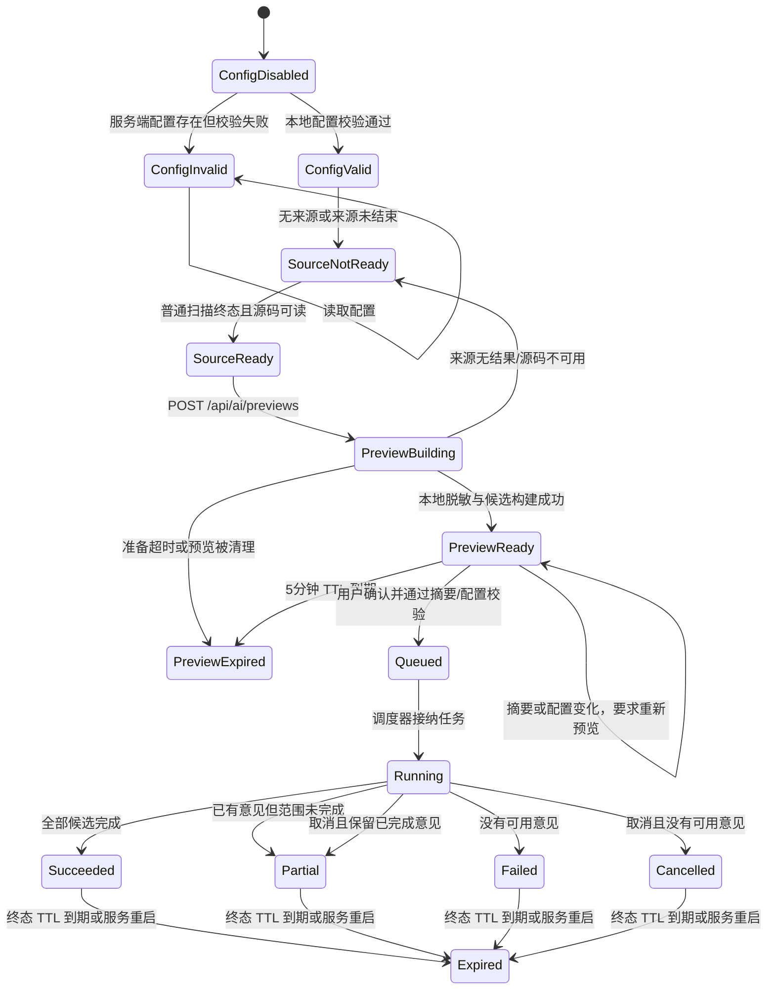
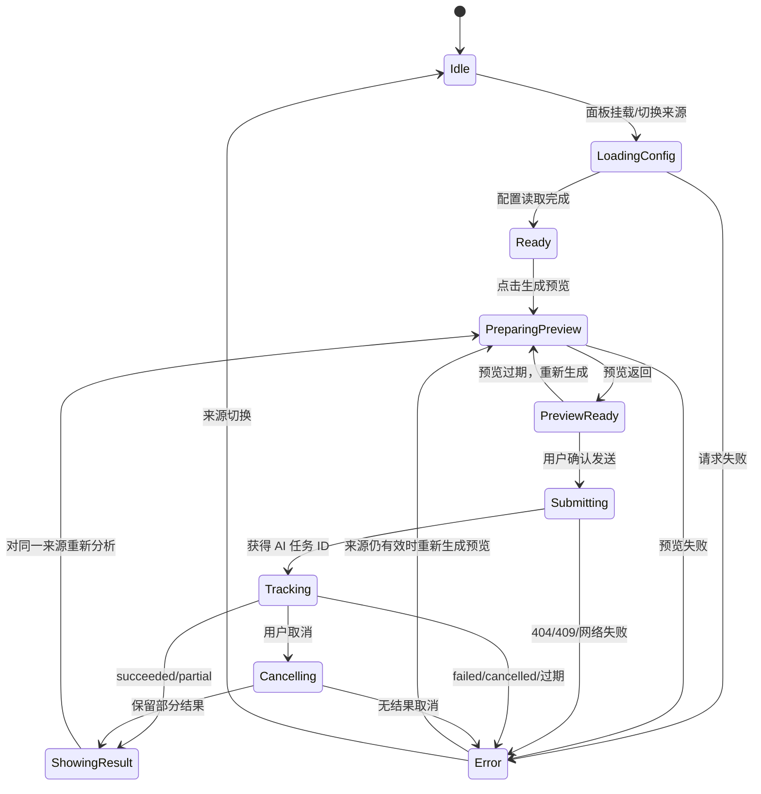

# AI 分析功能契约与状态流转

## 1. 文档目的

本文定义“AI 分析”从普通扫描结果到独立复核意见的功能边界、数据约束、状态转移和可观测行为，并用于核对后端、前端与测试是否一致。

AI 分析只产生待人工复核的独立意见。它不能改写静态发现、风险数量、迁移评分或普通扫描任务结果。

## 2. 功能契约

### 2.1 前置条件

| 条件 | 合同 |
| --- | --- |
| AI 配置 | 服务端配置有效且 `enabled=true`；“配置有效”只表示本地格式校验通过，不表示模型连通性已验证。 |
| 来源任务 | 来源必须是 `snippet`、`files`、`github` 或 `pypi`，且已进入终态并保留结果和源码路径。 |
| 用户确认 | 生成预览不发送模型请求；只有用户确认预览后才允许提交。 |
| 数据范围 | 模型只能收到预览中列出的脱敏候选和上下文；浏览器不能指定模型地址或凭据。 |

### 2.2 预览契约

预览由服务端根据来源任务当前结果生成，包含来源任务 ID、模型目标、预算、候选、脱敏上下文、候选覆盖范围、摘要和过期时间。

- 预览有效期为 5 分钟，最多 4 份，总序列化容量 2 MiB。
- 预览阶段不得产生模型网络请求。
- 提交必须同时匹配 `preview_id`、`digest` 和模型配置内部版本。
- 预览提交成功后立即消费；重复提交返回冲突。
- 预览过期只要求重新生成预览，不要求重新扫描仍然有效的来源任务。

### 2.3 AI 任务契约

AI 任务独立于来源任务，使用独立任务 ID 和结果文件。任务状态为：

`queued → running → succeeded | partial | failed | cancelled`

- `succeeded`：所有计划候选均完成，且存在有效意见结果。
- `partial`：存在已完成意见，但来源不完整、取消、截止时间或调用预算导致范围未完成。
- `failed`：没有可用意见结果，或模型配置/协议/请求失败导致任务不能形成有效结果。
- `cancelled`：任务在尚未形成结果前被取消；已完成意见可使任务最终落为 `partial`。
- 终态结果默认保留 15 分钟，服务重启后任务状态不可恢复。

每次模型发送计入 `ai_coverage.calls`；超时最多重试两次，退避 1 秒和 2 秒。取消、任务截止或调用预算耗尽时不得继续发送。

### 2.4 结果契约

结果至少包含来源任务 ID、输入摘要、候选覆盖、AI 覆盖、意见、诊断和用量。引用状态只描述脱敏文本片段是否匹配：

- `valid`：引用逐行匹配本次发送的脱敏文本；不代表模型判断正确。
- `invalid`：引用不存在、越界或文本不匹配。
- `absent`：模型没有提供引用。

失败或取消不能覆盖上一次有效意见。导出只允许导出 AI 结果白名单字段，不得包含凭据、完整源码或供应商原始错误体。

## 3. 状态流转

### 3.1 后端状态机

### 3.2 前端状态机

前端同时保存当前来源、预览、运行任务和上一次有效结果。切换来源时必须中止旧请求、清除当前预览和运行态，并恢复该来源自己的历史结果。

## 4. 实现核对矩阵（2026-10-22）

| 契约项 | 实现位置 | 证据 | 结论 |
| --- | --- | --- | --- |
| 配置默认关闭、公开字段不含凭据 | `backend/ai/config.py`、`backend/ai/routes.py` | `test_ai_config_models.py` | 已实现 |
| 预览只做本地准备 | `backend/ai/previews.py` | `test_preview_has_no_calls_and_task_independent_export` | 已实现 |
| 预览 TTL、容量和消费 | `backend/ai/previews.py`、`backend/ai/routes.py` | `test_preview_limits_cleanup_and_storage_failure`、`test_idempotency_consumption_expiration_and_conflict` | 已实现 |
| 摘要与配置版本绑定 | `backend/ai/routes.py` | `test_config_consent_boundary_and_capacity_no_calls` | 已实现 |
| AI 任务终态和部分结果 | `backend/task_store.py`、`backend/ai/runner.py` | `test_calls_budget_and_cancel_first_late_response`、`test_partial_static_scope_and_timeout_retain_diagnostics` | 已实现 |
| 取消不接纳迟到整批响应 | `backend/ai/runner.py`、`backend/task_store.py` | `test_cancel_discards_late_batch_and_keeps_complete_items` | 已实现 |
| 超时重试受预算和截止约束 | `backend/ai/provider.py`、`backend/ai/runner.py` | `test_timeout_retries_same_request_and_counts_each_send`、`test_timeout_retry_shares_task_call_budget_and_preserves_completed_batch` | 已实现 |
| 引用只作文本匹配验证 | `backend/ai/validation.py` | `AiValidationTests` 三项测试 | 已实现 |
| 来源切换隔离结果、迟到响应丢弃 | `web/src/utils/aiAnalysis.js` | `web/tests/aiAnalysis.test.js` | 已实现 |
| 刷新恢复任务 ID | `web/src/utils/aiAnalysis.js` | `刷新先恢复上次有效任务...` | 已实现，但过期提示存在语义偏差 |
| 任务/预览过期后的用户引导 | `web/src/utils/aiAnalysis.js` | 404 分支固定提示 | **部分实现**：来源任务仍有效时不应提示“重新扫描”，应提示“重新生成分析预览” |

## 5. 当前核对结论

当前后端状态、终态判定、取消边界、预览消费和调用预算与契约一致。用户当前页面中的来源任务 ID `a4b87441c9bd48d9b04b7ee9bc2a7d15` 仍可读取且已有结果；页面提示对应的是 AI 预览/AI 任务缓存过期，不是 GitHub 来源任务过期。

需要修正的用户可见状态文案是前端 404 分支：来源任务仍然存在时，应保留来源和静态结果，把操作引导到“生成本地脱敏预览”，不要求用户重新扫描。另需补充一个前端回归断言，确保过期 AI 任务清理任务 ID后仍可对当前来源重新生成预览。
