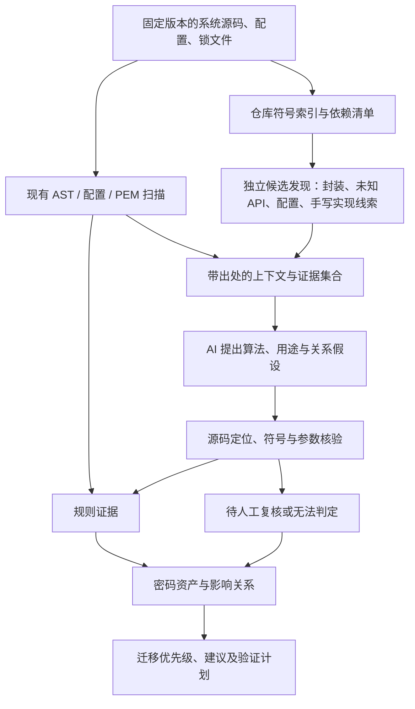

# 改进建议与 AI 方案调研

日期：2026-10-16（北京时间）  
核对版本：`c359a57`，V1.1.1。本文是调研与建议，新增能力均未实施。

## 1. 判断与项目现状

建议保留静态扫描，将研究目标收敛为“面向抗量子敏捷迁移的、证据可追溯的密码资产识别与影响分析”。AI 的价值应通过漏报补充、用途识别和人工复核成本的变化来验证。

代码仓库是有价值的输入。当前主要不足是：从“发现算法”到“判断用途、关联上层系统、制定迁移步骤、验证迁移效果”之间还缺少分析链条。只加一个读取结果的聊天框，无法填补这些缺口。

本次检查了 README、架构说明、组会记录，以及扫描入口、Python 调用解析、评分、热门采集与榜单组件。

| 当前证据 | 对下一步的意义 |
| --- | --- |
| `scanner/engine.py::analyze_source` 按单文件分派 Python AST、结构化配置和文本扫描 | 保留为确定性基础层；仓库级上下文需要另外建立 |
| Python 调用识别依赖完整导入目标与绑定信息 | 已有机制有助于减少误报；不能直接宣称跨模块数据流或运行时可达性 |
| `scanner/results.py::build_migration_score` 使用 `min(100, 高风险项×25 + 受影响文件×10 + 算法种类×10)` | 分数很容易饱和，难以比较不同项目；不能解释为风险概率 |
| `backend/popular.py` 检索 `topic:cryptography language:python` 并按 Star 排序 | 是热门密码仓库样本，不是代表性业务系统，更不是风险排名 |
| `PopularView.vue` 列表显示 Star、发现数、扫描范围与迁移分数 | 下一步应让用途、证据状态和优先行动更直观 |
| 图中当前文件—算法来自扫描，迁移方向来自静态知识 | 可复用图交互，但真实依赖、调用和建议必须分别建模 |
| README 明确没有数据库、LLM、真实依赖传播与自动代码迁移 | 答辩需要区分已实现成果、实验结果和研究计划 |

本次同步后，本机运行 Python unittest 225 项和前端 Node 测试 52 项，全部通过。没有运行输入代码或风险样例，没有对第三方系统发起扫描；没有实测以下外部工具的识别效果。测试通过是工程回归证据，不是 Precision/Recall 实验。

## 2. 值得参考的开源仓库

以下能力来自维护者的项目文档与论文；适配性判断是本次建议，不能当作本项目已复现的效果。采用前应固定提交与依赖，单独验证输入、输出与资源成本。

| 项目 | 核心能力与可借鉴内容 | 与本项目的距离及采用建议 |
| --- | --- | --- |
| [CRYPTBARA](https://github.com/choseogyeong/CRYPTBARA) | ASE 2025 的 Python 密码 API 误用检测；结合 Joern、Python AST、依赖信息和 LLM | 最贴近当前 Python 分析方向。优先研究上下文提取和提示构造；它检测密码误用，并非专用 PQC 迁移识别器。README 的 Joern 用途是过程内数据流，不能据此宣称完整跨模块能力。引入 Java/Joern 会增加桌面打包成本；首页未见明确许可证，复用源码前需核对授权 |
| [IRIS](https://github.com/iris-sast/iris) | MIT；LLM 生成分析规格、CodeQL 分析并由 LLM 过滤候选路径；有 ICLR 2025 研究背景 | 适合作为神经符号方法参考及实验设计参考。当前仓库默认 v2，论文复现材料在 v1；主要研究 Java 通用漏洞，不是可直接嵌入当前扫描器的密码模块 |
| [quantakrypto/pqc-tools](https://github.com/quantakrypto/pqc-tools) | Apache-2.0；扫描、可选 LLM triage、迁移工具、CI 与一致性测试；`packages/agent` 隔离模型接口 | 与产品目标直接相关。优先看 AI 复核接口、证据输出、迁移后验证流程。属于需自行验收的工具候选，README 的语言数量和功能清单不能作为准确率证明 |
| [CBOMkit](https://github.com/cbomkit/cbomkit) / [Sonar Cryptography](https://github.com/cbomkit/sonar-cryptography) | Apache-2.0；密码资产发现、CycloneDX CBOM、可视化和策略检查 | 适合做共同支持语言/密码库上的基线，借鉴资产关系和标准输出。整体 Sonar/Java 服务栈较重，建议独立运行并导入结果，不替换当前轻量后端；文档中的库覆盖声明不等于真实项目召回率 |
| [cryto-code-detect](https://github.com/MuralidharB/cryto-code-detect) | 维护者提供规则、LLM、混合检测与难度分层语料，关注手写、无库和间接密码实现 | 适合作为“规则未命中时如何找候选”的实验参考；其高分来自自建语料，本次未复现，不能迁移为本项目性能结论，也不应只按模型自报置信度确认风险 |
| [PostQuant](https://github.com/postquantdev/postquant) | MIT；源码、TLS、Python/JS AST 与用途信号 | 适合比较用途标签与网络/源码证据的展示。文档中的上下文分析不等于 LLM；不要照搬零发现即高等级、AST 即 verified 等判断方式 |
| [cdxgen](https://github.com/cdxgen/cdxgen) | CycloneDX BOM 生成及多种生态依赖采集 | 优先导入既有 SBOM 或解析锁文件，避免重复造依赖采集器；依赖存在不代表调用可达。接入前核对具体模式是否调用包管理器或构建过程，保留本项目不执行不可信输入的边界 |
| [liboqs-python](https://github.com/open-quantum-safe/liboqs-python) | MIT；PQC KEM/签名原型与实验接口 | 用于受控迁移实验，不是扫描器，也不是安全认证。运行依赖 liboqs；优先独立实验环境，不立即加入桌面发行依赖 |

CRYPTBARA 的[研究制品](https://zenodo.org/records/15561335)提供独立归档，可用于固定复现材料。若做论文结果对比，必须核对威胁定义与任务是否相同。

另有直接研究 LLM 迁移的[2026 年预印本](https://arxiv.org/abs/2606.07341)：采用成对 Python 片段和功能测试。其[全文数据可用性声明](https://arxiv.org/html/2606.07341v1)明确说明评估代码尚未公开，因此只能作为方法与数据线索，不能列为已可复现的开源实现。

## 3. 建议的技术路线

### 3.1 静态层先补充“用途与对象”

从算法名称扩展到操作、密钥对象、参数与调用位置。例如生成密钥、签名、验签、密钥协商、证书加载、JWT 验证应分别记录。通过已知构造器和对象流追踪 `key.sign()` 的来源，比仅扩大名称匹配范围更有价值。

第一阶段优先实现 Python 项目内导入解析、直接调用关系、常量参数传播和少量封装函数摘要。对动态导入、反射、外部库内部行为保留未知状态。先实现一个清晰且可测试的子集，再按实验错误分析扩展。

密码库实现 RSA、业务系统实际使用 RSA、测试中验证 RSA 是不同事实。测试文件不能直接当作无风险，也不能与生产使用混为一谈。

### 3.2 AI 同时参与候选发现与上下文复核

如果 AI 只看到已有 findings，它只能尝试复核误报，无法发现扫描器未命中的密码使用。因此设置两条来源：原扫描发现，以及独立检索得到的未知 API、业务封装、数学运算和配置候选。

不要把所有文件整仓发送给模型。先建立符号与引用索引，再按候选取函数、调用者、导入目标和相关配置；针对未命中文件做分层抽样审计，以测量候选生成阶段的漏报。数学运算只能作为线索，例如模幂操作本身不能直接证明 RSA。

AI 输出必须引用 `source_id`、行范围、原文片段和关系依据；输出算法家族、用途、推断前提、缺失上下文、支持或反对证据以及弃答状态。源文件只是待分析数据，不能让其中的指令改变分析流程。

本地程序核对文件、行号、片段、符号解析与参数约束。核对通过说明证据确实存在，仍不自动证明实际执行、完整协议安全或迁移正确性。

保留规则原始结果，另存 AI 意见与人工裁定。模型不能静默删除规则命中；发生冲突时进入复核。模型不可用时保留完整静态结果，并标明 AI 阶段未完成。新增模型调用需要显式的数据发送设置，仅传必要且脱敏的上下文。

### 3.3 依赖关系要能追溯

采用“系统—项目—包版本—文件/符号—算法/操作”的身份模型。锁文件提供版本依赖，导入解析提供代码引用，调用分析提供调用关系，配置提供算法选择约束。每条边记录来源文件、版本和识别方式。

依赖关系、可能调用、配置启用和实际运行观测是不同证据，不能把 SBOM 中存在某包自动判为业务已受影响。第一版无需 Neo4j，可先使用结构化数据和轻量持久化；数据库和图数据库应由实际查询需求决定。

### 3.4 大规模敏捷迁移需要“增量与闭环”

按仓库提交、文件内容和分析器版本缓存静态分析；AI 缓存还要包含上下文摘要、模型与提示版本。文件变化后，除了重扫本文件，还要使受影响的调用者摘要失效。

复用现有容量限制、取消和部分结果机制。为 AI 单独设置请求数、上下文、时间和成本预算，不把静态扫描完成进度伪装成 AI 完成进度。

迁移建议先形成变更方案及补丁草案；只在受控副本中进行依赖、功能、互操作、失败路径和性能测试，再次扫描对比残留风险。测试通过仍不等于形式化证明。

迁移必须按用途选择：ML-KEM 用于密钥封装，ML-DSA/SLH-DSA 用于签名，不能机械地把所有 RSA 调用替换为 ML-KEM；协议、序列化与对端兼容性也需要验证。[NIST PQC 项目](https://csrc.nist.gov/projects/post-quantum-cryptography/)

## 4. 如何展示识别效果与可验证性

首先分别定义三个任务：密码资产发现、用途/量子脆弱性分类、迁移建议正确性。它们需要不同标签和指标。传统安全用法也可能依赖量子脆弱公钥算法，普通密码误用数据集的 secure 标签不能直接作为 PQC 安全标签。

建议先准备约 300–500 个正负样例和 6–10 个固定版本真实项目；这是实施规模建议，不是已有数据。语料应覆盖直接调用、别名、遮蔽、对象方法、包装、跨文件、配置选择、动态行为、手写实现、测试与普通数学运算。人工标注规则先固定，由两人独立标注并裁定分歧。

按项目拆分开发集与测试集，避免同一项目或等价变形落入两边。标注者不能只看工具报警，应独立审阅限定范围，才能估计漏报。对无法穷尽审查的真实项目，报告抽样范围与未标注部分，不宣称完整仓库召回率。

| 对照组 | 要回答的问题 |
| --- | --- |
| A：当前扫描器，固定为本次基线 | 现有方法的误报和漏报分布 |
| B：在共同输入范围内使用纯 LLM | 无静态证据约束时的收益、幻觉与成本 |
| C：静态扫描 + AI 复核 | 仅复核是否降低误报、是否错误否定真实发现 |
| D：独立候选 + 上下文 + AI + 核验 | 是否补回原规则漏报，收益来自哪一阶段 |
| E：可适配的外部扫描器 | 与成熟工具在共同支持范围上的差距 |

主指标采用 Precision、Recall、F1，另报算法家族与用途分类、有效证据引用率、弃答率、AI 错误否定率、人工复核耗时、每千行耗时和调用成本。统计单位可定义为“位置+算法+操作”的去重资产，另报文件级指标；在实验前固定匹配规则。

AI 候选结果、经核验结果和人工最终结果分别计算指标。弃答不从召回率分母静默消失；使用选择性预测时同时报告覆盖率。相同样本重复运行并报告波动或置信区间。固定提交、模型标识、参数、规则、提示和原始响应，确保可复查。

[CryptoAPI-Bench](https://github.com/CryptoAPI-Bench/CryptoAPI-Bench)可以借鉴安全/不安全样例和复杂数据流用例组织方式，但它针对 Java 密码误用，不能原封不动作为当前 Python PQC 检测准确率的数据集。

“可证明性”第一阶段应明确表述为：证据可追溯、实验可复现、效果可度量。若要声称形式化正确性或完备性，还需明确语言子集、假设、性质与证明；模型解释和回归测试本身不构成这种证明。

## 5. 代表性系统与演示场景

建议先做两个纵向场景，而不是持续扩大 Star 榜单：

1. 身份认证：自建小型认证系统，接入固定版本的 [Authlib](https://github.com/authlib/authlib)，追踪 JWT/JWS 的配置、签名与验签路径。
2. 运维通信：自建运维客户端，接入固定版本的 [Paramiko](https://github.com/paramiko/paramiko)，分析 SSH 主机密钥、签名与密钥交换的不同用途。

这两者分别提供认证协议与通信协议案例，均是候选实验对象，本次未扫描验证。大型真实系统可作为后续外部案例，先核对语言覆盖、锁定依赖和可独立审查的模块范围。

演示应能从一个上层功能下钻到实际版本、依赖/调用边、算法操作和源码，再展示迁移约束与复核记录。协议没有对应支持时，应输出阻碍条件，而不是生成看似可用的算法替换方案。

## 6. 前端与榜单改进

提高密度优先减少重复说明和卡片空白，保留证据与状态；不要单纯缩小字号。桌面采用紧凑表格，窄屏转为摘要列表，选中项在详情区展开。

建议列表字段：系统/仓库、版本、使用场景、确认资产数、待复核数、关键算法/操作、生产/测试/未知用途、扫描完整性、迁移阻碍、更新时间。未标注或未知状态不要用 0 和绿色替代。

| 用户要完成的事 | 推荐视图 |
| --- | --- |
| 找出下一步优先处理的系统 | 迁移优先级列表，展示排序依据与缺失业务信息 |
| 比较一批项目的密码分布 | 项目×算法/用途热力图，点击进入对应证据 |
| 判断某个包会影响哪些上层功能 | 可逐层展开的依赖/调用子图，每条边有出处 |
| 判断 AI 的结论能否采信 | 原始代码、静态事实、AI 意见、核验和人工裁定并列 |
| 验证一次迁移是否有效 | 前后资产变化、测试结果、残留风险和兼容性阻碍 |

榜单提供“热门项目”和“迁移优先级”两个明确排序入口。优先级参考用途、数据保密期限、外部暴露、依赖影响、替代方案与工作量；缺失业务信息要求补充或标为未知。发现数、风险密度和文件数可辅助比较，但都不能单独作为风险大小。

将“识别可信程度”与“迁移紧迫程度”分别展示。AI 自报置信度只有经过本地评估校准后，才可讨论概率含义。保留现有范围和异常提示，低覆盖结果不能与完整扫描进行无条件排名。

导向流程建议为：选择系统/目标 → 确认范围 → 查看关键结论 → 复核证据 → 生成迁移计划 → 查看验证结果。通过任务完成率、找证据耗时和下一步操作是否清晰进行用户测试，再决定图表布局。

## 7. 实施顺序与答辩表达

| 阶段 | 交付物 | 验收依据 |
| --- | --- | --- |
| 1：先建立基线 | 标签规范、固定样例/项目、现扫描器结果与错误分析 | 可复现 P/R/F1；明确未覆盖范围 |
| 2：做最小 AI 增强实验 | 上下文提取、独立候选、结构化 AI 输出、核验与弃答 | 共同测试集上的增益、波动、成本；定位无效或有害环节 |
| 3：完成系统纵向链路 | 两个系统案例、版本依赖、有限调用关系、用途标签 | 每条关系可追溯，未知可见，不能虚构传播 |
| 4：迁移与界面闭环 | 紧凑列表/热力图/证据下钻、受控迁移案例、前后对照 | 用户任务表现、兼容性/功能/性能测试与重扫差异 |

大规模能力用实际吞吐、峰值资源、增量重扫节省和 AI 成本证明，避免只展示一次扫描很多仓库的截图。

建议答辩主线：实际场景与漏报问题 → 现有静态基线 → 证据约束的 AI 与上下文方法 → 对照实验 → 系统影响链路 → 迁移验证案例。已有扫描、资源控制、源码定位、回归与交付属于工程工作；新的识别和迁移方法是否有研究贡献，取决于实验和相对于已有方法的增量。

本阶段最优先投入的是基准集与一条可验证的 AI 分析链路。模型微调、多智能体和大型图数据库放到出现明确瓶颈后再考虑。
